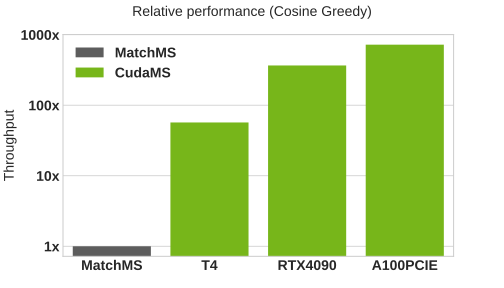
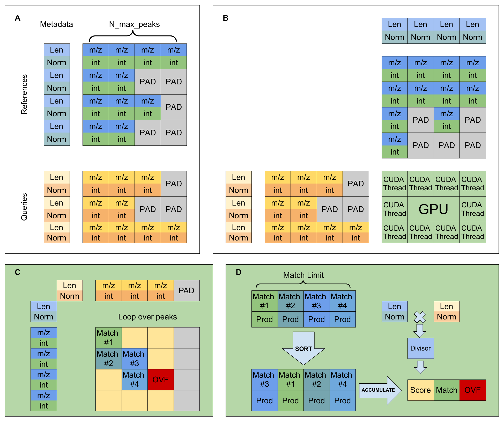

# SimMS

<table>
<tr>
  <!-- Disable huggingface space until there's any demand -->
  <td>
    <a href="https://huggingface.co/spaces/TornikeO/simms" rel="nofollow"></a>
  </td>
  <!-- Needs an update -->
  <!-- <td>
    <a target="_blank" href="https://colab.research.google.com/drive/1ppcCy5gTWUaOQdnH4eXqyEn2hBaQRolR?usp=sharing">
      
    </a>
  </td> -->
  <td>
    <a target="_blank" href="https://colab.research.google.com/github/PangeAI/simms/blob/main/notebooks/samples/colab_tutorial_pesticide.ipynb">
      
    </a>
  </td>
  <td>
    <a target="_blank" href="https://colab.research.google.com/github/PangeAI/simms/blob/main/notebooks/samples/upload_your_own_mgf.ipynb">
      
    </a>
  </td>
</tr>
</table>

Calculate the similarity between a large number of mass spectra using a GPU. SimMS aims to provide very fast replacements for commonly used similarity functions in [matchms](https://github.com/matchms/matchms).

<div style='text-align:center'>
  
  
  
</div>

# How SimMS works, in a nutshell



Comparing large sets of mass spectra can be done in parallel since scores can be calculated independently of each other. 
By leveraging a large number of threads in a GPU, we created a GPU program (kernel) that calculates a 4096x4096
 similarity matrix in a fraction of a second. 
By iteratively calculating similarities for batches of spectra, SimMS can quickly process datasets much larger than the GPU's memory. 
For details, visit the [preprint](https://www.biorxiv.org/content/biorxiv/early/2024/07/25/2024.07.24.605006.full.pdf).

# Quickstart

## Hardware

Any GPU [supported](https://numba.pydata.org/numba-doc/dev/cuda/overview.html#requirements) by Numba can be used. We tested a number of GPUs:

- GTX 1050 Ti
- RTX 2070
- T4 GPU (free on [Google Colab](https://colab.research.google.com/))
- RTX 4090 (on vast.ai)
- A100 80GB (on vast.ai)
- H100SXM 80GB (on vast.ai)

Performance (comparisons/s) is proportional to the peak GPU bandwidth (GB/s).

The `pytorch/pytorch:2.2.1-cuda12.1-cudnn8-devel` docker [image](https://hub.docker.com/layers/pytorch/pytorch/2.2.1-cuda12.1-cudnn8-devel/images/sha256-42204bca460bb77cbd524577618e1723ad474e5d77cc51f94037fffbc2c88c6f?context=explore) was used for development and testing. 

## Install
```bash
# Pick the extra matching your CUDA driver: cu12 or cu13
pip install "simms[cu12] @ git+https://github.com/PangeAI/simms"
```

The `cu12` / `cu13` extra installs the CUDA compiler pieces Numba needs (NVVM, libdevice) from pip, through [numba-cuda](https://github.com/NVIDIA/numba-cuda). Without an extra, Numba uses a CUDA toolkit installed on the system.

The extra has to match the CUDA major version of your PyTorch build, which `python -c "import torch; print(torch.version.cuda)"` prints. Recent PyTorch wheels on PyPI are built for CUDA 13, so in a fresh environment `cu12` resolves to the newest PyTorch built for CUDA 12, and `cu13` to the newest PyTorch. If PyTorch is already installed, pick the extra that matches it, or pip may replace it.

## Use with MatchMS

```py
from matchms import calculate_scores
from matchms.importing import load_from_mgf
from simms.utils import download
from simms.similarity import CudaCosineGreedy, \
                              CudaModifiedCosine, \
                              CudaFingerprintSimilarity

sample_file = download('pesticides.mgf')
references = list(load_from_mgf(sample_file))
queries = list(load_from_mgf(sample_file))

similarity_function = CudaCosineGreedy()

scores = calculate_scores( 
  references=references,
  queries=queries,
  similarity_function=similarity_function, 
)

scores.scores_by_query(queries[42], 'CudaCosineGreedy_score', sort=True)
```

# Supported similarity functions

- `CudaModifiedCosine`, equivalent to [ModifiedCosine](https://matchms.readthedocs.io/en/latest/api/matchms.similarity.ModifiedCosine.html)
- `CudaCosineGreedy`, equivalent to [CosineGreedy](https://matchms.readthedocs.io/en/latest/_modules/matchms/similarity/CosineGreedy.html)
- `CudaFingerprintSimilarity`, equivalent to [FingerprintSimilarity](https://matchms.readthedocs.io/en/latest/_modules/matchms/similarity/FingerprintSimilarity.html) (`jaccard`, `cosine`, `dice`)

- More coming soon - **requests are welcome**!


# Installation
The **easiest way** to get started is to use the <a target="_blank" href="https://colab.research.google.com/github/PangeAI/simms/blob/main/notebooks/samples/colab_tutorial_pesticide.ipynb">colab notebook
</a>  that has everything ready for you.

For local installations, we recommend using [`micromamba`](https://mamba.readthedocs.io/en/latest/installation/micromamba-installation.html), it is much faster. 

SimMS needs Python 3.11–3.14. Total size of install will be around 7-8GB (heaviest packages are `pytorch` and the CUDA libraries).

```bash
# Install torch for your CUDA version (follow the official guide https://pytorch.org/get-started/locally/#start-locally)
pip install torch

# Install this repository, with the CUDA pieces for Numba from pip: the extra matching torch.version.cuda (cu12 or cu13)
pip install "simms[cu13] @ git+https://github.com/PangeAI/simms"
```

With conda, install `cuda-toolkit` and `numba-cuda` from conda-forge instead of using the extra.

## Run in docker

The `pytorch/pytorch:2.4.1-cuda12.4-cudnn9-devel` image (Python 3.11) has nearly everything you need. Once inside, do:

```sh
pip install "simms[cu12] @ git+https://github.com/PangeAI/simms"
```

Older images need care: `pytorch/pytorch:2.2.1-cuda12.1-cudnn8-devel` ships PyTorch built against NumPy 1, which current releases of SimMS's dependencies replace with NumPy 2.

## Run on vast.ai

Use [this template](https://cloud.vast.ai/?ref_id=51575&template_id=f45f6048db515291bda978a34e908d09) as a starting point, once inside, simply do:

```sh
pip install git+https://github.com/PangeAI/simms
```

# Frequently asked questions

### I want to get `referenece_id`, `query_id` and `score` as 1D arrays, separately. How do I do this?

Use the `"sparse"` mode. It directly gives you the columns. You can set `sparse_threshold` to `0`, at which point you will get *all* the scores.

```py
from simms.similarity import CudaCosineGreedy

scores_cu = CudaCosineGreedy(
    sparse_threshold=0.75, # anything with a lower score gets discarded
).matrix(references, queries, array_type='sparse')

# Unpack sparse results as 1D arrays
ref_id, query_id, scores = scores_cu.data['sparse_score']
ref_id, query_id, matches = scores_cu.data['sparse_matches']
```


# Citing SimMS  

```bibtex
@article{onoprishvili2025simms,
  author  = {Onoprishvili, Tornike and Yuan, Jui-Hung and Petrov, Kamen and Ingalalli, Vijay and Khederlarian, Lila and Leuchtenmuller, Niklas and Chandra, Sona and Duarte, Aurelien and Bender, Andreas and Gloaguen, Yoann},
  title   = {SimMS: A GPU-Accelerated Cosine Similarity implementation for Tandem Mass Spectrometry},
  journal = {Bioinformatics},
  year    = {2025},
  month   = {02},
  doi     = {10.1093/bioinformatics/btaf081}
}
```
